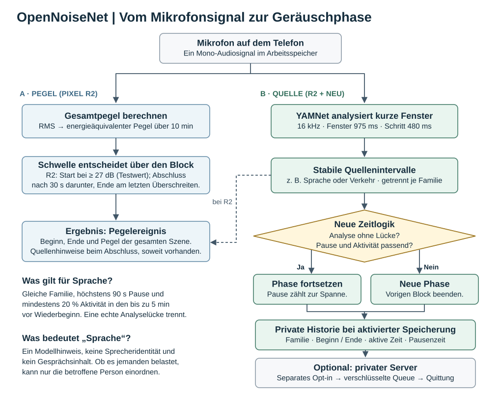

# Wie OpenNoiseNet Geräuschphasen bildet

**Zwei Fragen, zwei Zeitachsen.** Der Pixel-Testbuild R2 entscheidet anhand des gleitenden Gesamtpegels, ob ein Pegelereignis vorliegt. Beim Abschluss fragt er Quellenhinweise ab; der Tracker hält abgeschlossene Intervalle regulär rund 30 Minuten vor. Ein langer Pegelblock kann deshalb nur wenige Quellenhinweise enthalten. Die 27 dB sind eine unkalibrierte Testeinstellung. Sie bezeichnen keine Belästigungsgrenze.

Die neue Zeitlogik bildet unabhängig von diesem Schwellenwert eigene Phasen je Quellenfamilie. Überlappende Sprach- und Verkehrshinweise dürfen zwei gleichzeitige Phasen ergeben. Unbestätigte oder unbekannte Quellen erzeugen keine eigene Phase. Als Blockdauer zählt die Zeit vom ersten bis zum letzten berücksichtigten Hinweis. Die vereinigten aktiven Intervalle und die eingeschlossenen Pausen werden getrennt ausgewiesen. Der gemischte Szenenpegel lässt sich keiner einzelnen Quelle zuweisen.

**Beispiel mit vorgegebenen Sprachhinweisen, keine Feldmessung.** Auf 40 Sekunden Sprache folgen 20 Sekunden Denkpause und weitere 30 Sekunden Sprache. Bei durchgehend analysierter Zeit reicht die Aktivität zum Verbinden: 90 Sekunden Block, 70 Sekunden aktiv, 20 Sekunden Pause. Fehlen die Analysefenster zwischen diesen Sprachabschnitten, liefert derselbe Dart-Kern zwei Phasen von 40 und 30 Sekunden. Das Beispiel prüft die Zeitlogik, nicht die Erkennungsrate des Modells. YAMNet kann Sprache als mögliche Quelle nennen; es erkennt weder das diktierte Projekt noch die persönliche Belastung.

**Datenweg.** Der Phasenupload ist separat freizugeben, standardmäßig aus und setzt aktivierte private Historie voraus. Er überträgt Quellenfamilie und Zeitmetadaten ohne Audio, Transkript, Standort oder quellenspezifischen Pegel. Bei fehlender Bestätigung bleibt die verschlüsselte Warteschlange zur Wiederholung erhalten. Eine kurze Diktierprobe auf dem Pixel 10a hat den Weg bis zur bestätigten Serverrevision über privates HTTPS durchlaufen. Für das Ablaufdiagramm ist die Zeitgrenze der Freigabe relevant. Lokale Historie und Upload beginnen ihre Auswertung ab ihrer jeweiligen Aktivierung. Ein späterer Uploadstart kann deshalb bei denselben nachfolgenden Geräuschen eine andere Blockgrenze ergeben.

**Belege im Code:** [Mikrofon und YAMNet](on-device-sound-analysis.md), [Pegelereignisse](../../mobile/lib/services/event_detection_service.dart), [Quellenintervalle](../../mobile/lib/services/sound_analysis/sound_source_activity_tracker.dart), [Zeitregeln und Blockdauer](../../mobile/lib/services/sound_analysis/acoustic_phase.dart), [privater Upload und natürliche Referenzgespräche](source-phase-upload.md). [Editierbare Spezifikation der interaktiven Ansicht](geraeuschverarbeitung.workflow.json).
